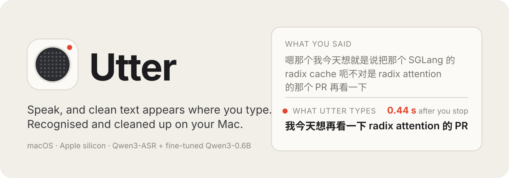
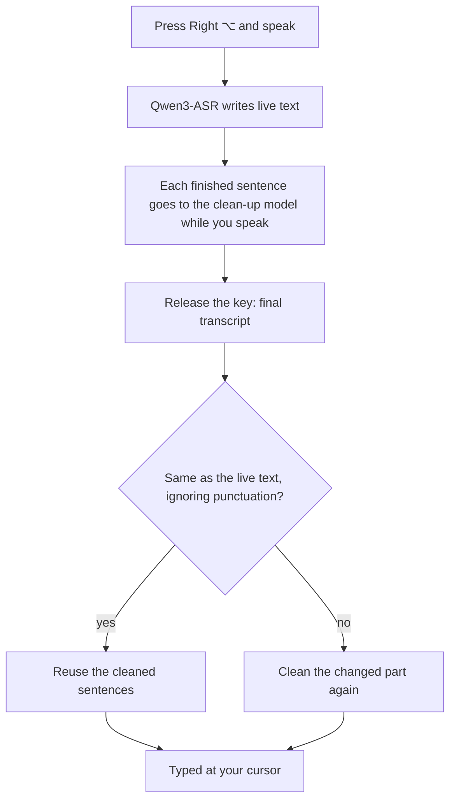
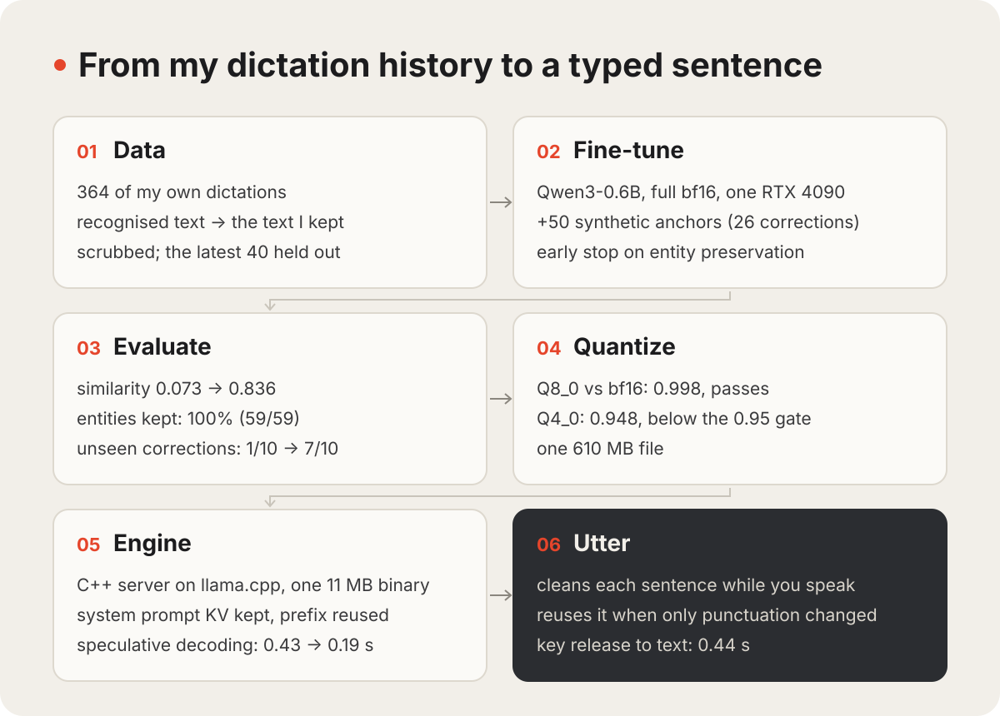

<p align="center">
  
</p>

<p align="center">
  <a href="https://github.com/cassieliang6709/utter/releases/latest"><b>Download for Mac</b></a> ·
  <a href="https://huggingface.co/liangyue36/qwen3-0.6b-dictation-polish-GGUF">Model on Hugging Face</a> ·
  <a href="README.zh-CN.md">中文</a>
</p>

Utter is voice dictation for macOS that runs entirely on your Mac. Press a key, speak, press it again: speech recognition (Qwen3-ASR 0.6B) and clean-up (a Qwen3-0.6B fine-tuned on dictation) both run locally, and the text is typed where your cursor is.

It is built on [Voxt](https://github.com/sgl-project/sglang-omni/tree/main/Voxt) from SGLang-Omni. The `cassie` branch adds about 25 commits on top of upstream; the rest of this repository's history is upstream's, kept so the branch can follow new upstream releases.

## Results

M1 Pro, 16 GB. Five Chinese dictations of 7–39 s replayed through the real app pipeline, three runs each. Time from releasing the key to the inserted text, median.

| Clean-up model | Clean up while speaking: off | on |
|---|---|---|
| Qwen3-4B-Instruct Q4_0, llama.cpp | 1.31 s | 0.57 s |
| Fine-tuned Qwen3-0.6B Q8_0, bundled engine | 0.48 s | **0.44 s** |

Speech recognition takes 0.28 s of the 0.44 s. Per-recording numbers and the method are in [UTTER.md](../UTTER.md).

## How a dictation flows



Upstream Voxt already cleans up while you speak, but turns it off when the model runs on your own Mac, and drops the cleaned sentences when the final transcript differs from the live one by a single comma. Utter turns it on for a local model, matches the two texts ignoring punctuation, white space and case, and keeps it on with dictionaries of more than 30 terms.

## From 0 to 1

<p align="center">
  
</p>

1. **Data.** 364 of my own dictations from earlier use: what speech recognition heard, and the text I kept. I cleaned them by script and by hand and scrubbed personal details. The latest 40 by time are held out for evaluation; the data is not published.
2. **Fine-tune.** Full-parameter bf16 fine-tuning of Qwen3-0.6B on one RTX 4090 (peak 6.39 GiB, about 3 minutes an epoch), with the loss on the answer only and thinking off. I added 50 synthetic anchor pairs, 26 of them mid-sentence corrections ("radix cache, no, radix attention"), because the first model kept both versions. Training stops on entity preservation, not on loss: epoch 2 scored a slightly higher similarity but lost two entities.
3. **Evaluate.** On the 40 held-out dictations, character similarity to the kept text rose from 0.073 (zero-shot: 30 of 40 outputs ran longer than 1.5 times the input) to 0.836, with every speech-recognised entity kept (59 / 59). On 10 unseen corrections, 7 pass, against 1 before the anchors.
4. **Quantize.** Converting to GGUF for Apple silicon can change behaviour without any error, so every quantization is compared with the bf16 outputs under the same prompt and greedy decoding. Q8_0 scores 0.998 and is kept (610 MB); Q4_0 scores 0.948, below the 0.95 gate.
5. **Engine.** A C++ server on llama.cpp, built as one 11 MB binary with no other dependencies. It keeps the system prompt's KV cache resident and reuses the common prefix of streaming requests (340 → 149 prefill tokens over 12 steps), and decodes with n-gram speculation (0.43 → 0.19 s median on the held-out set, same outputs). Published on [Hugging Face](https://huggingface.co/liangyue36/qwen3-0.6b-dictation-polish-GGUF); training and engine code in [voxt-polish](https://github.com/cassieliang6709/voxt-polish).
6. **Utter.** The app changes above, a local-only interface (one speech model, no cloud services, no Translate / Rewrite / Meetings pages, no update checks), and the engine inside the app: on first start Utter downloads the model, checks its SHA-256, resumes if the network drops, and runs the engine itself. Every change has a test that fails with the change reverted.

## Install

Needs an Apple silicon Mac with macOS 15 or later.

1. Download the `.dmg` from [Releases](https://github.com/cassieliang6709/utter/releases/latest), open it and drag **Utter** to **Applications**.
2. The app is not notarized yet, so macOS blocks it on first launch. Allow it once:
   ```sh
   xattr -dr com.apple.quarantine /Applications/Utter.app
   ```
3. Open Utter. The setup guide asks for **Microphone** and **Accessibility** access and downloads the speech model (Qwen3-ASR 0.6B, about 0.7 GB). The clean-up model (610 MB) downloads by itself; a card at the bottom left shows its progress.
4. Press **Right ⌥**, speak, press it again.

Already run a language model on your Mac? If one is set up in Settings → Language models, Utter uses it and downloads nothing.

## Build from source

Needs Go 1.27.4, Xcode, CMake, and the official [Voxt](https://github.com/sgl-project/sglang-omni/releases) in `/Applications` (its speech runtime is reused instead of building it).

```sh
git clone https://github.com/cassieliang6709/voxt-polish.git ~/Developer/voxt-polish
~/Developer/voxt-polish/cpp/build-static.sh        # the clean-up engine
git clone -b cassie https://github.com/cassieliang6709/utter.git
cd utter/Voxt
scripts/build-helper.sh
scripts/build-utter.sh                              # -tags utter, installs /Applications/Utter.app
```

Tests:

```sh
scripts/check.sh
CGO_ENABLED=0 go test ./...
CGO_ENABLED=0 go test -tags utter -run TestUtterProfile .
```

## Limits

- Tuned on one person's Chinese dictation with English terms. Other languages and accents are untested.
- Corrections said as "X 不对是 Y" still fail in 3 of 10 test cases.
- Measured on one Mac (M1 Pro, 16 GB).
- Utter shares its data folder with the official Voxt (`~/Library/Application Support/VoxtNew`): dictionary, history and settings carry over. Both use Right ⌥, so run one at a time.

## Credits

Voxt and SGLang-Omni are by the SGLang-Omni team, Apache-2.0; Utter keeps the same licence ([LICENSE](../LICENSE), [Voxt/NOTICE](../Voxt/NOTICE)). Clean up while you speak is upstream's ([#4592](https://github.com/sgl-project/sglang-omni/pull/4592)); the local-model switch was also proposed upstream in [#4643](https://github.com/sgl-project/sglang-omni/pull/4643). The clean-up model is fine-tuned from [Qwen3-0.6B](https://huggingface.co/Qwen/Qwen3-0.6B).
