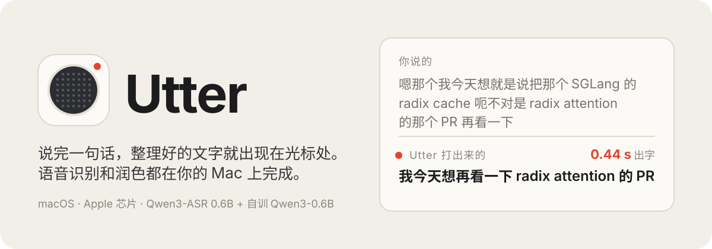
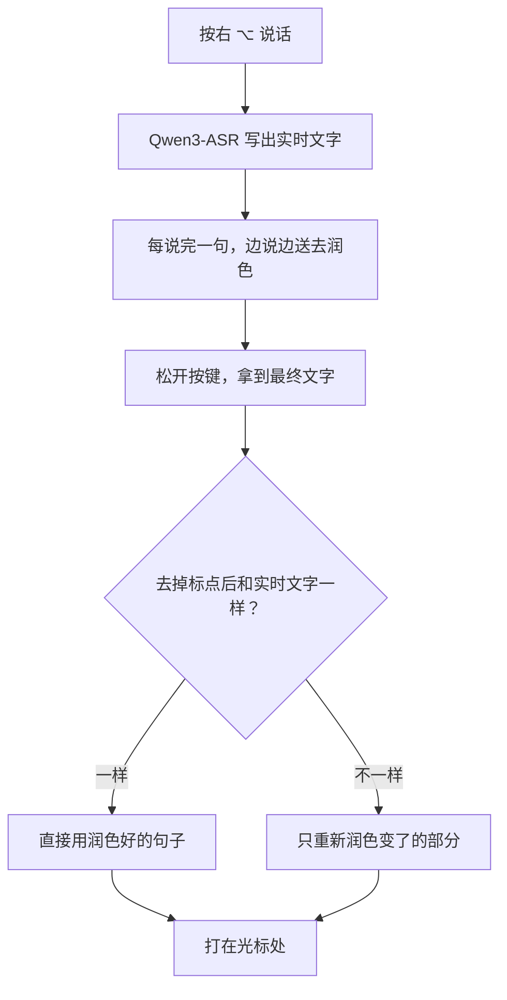
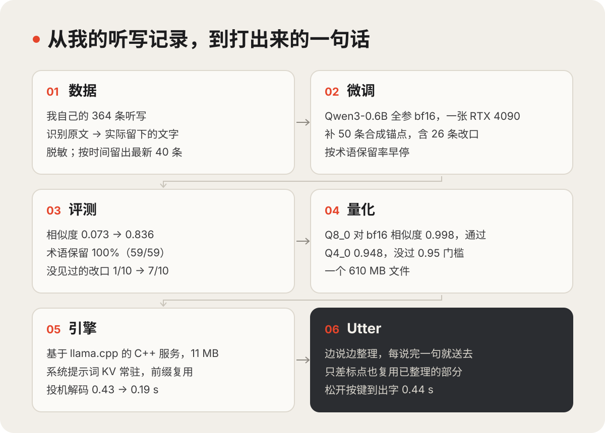

<p align="center">
  
</p>

<p align="center">
  <a href="https://github.com/cassieliang6709/utter/releases/latest"><b>下载 Mac 版</b></a> ·
  <a href="https://huggingface.co/liangyue36/qwen3-0.6b-dictation-polish-GGUF">Hugging Face 上的模型</a> ·
  <a href="README.md">English</a>
</p>

Utter 是 macOS 上的语音输入，全程在你的 Mac 上运行。按一下快捷键，说话，再按一下：语音识别（Qwen3-ASR 0.6B）和润色（专门为听写微调的 Qwen3-0.6B）都在本机完成，文字打在光标处。

它基于 SGLang-Omni 里的 [Voxt](https://github.com/sgl-project/sglang-omni/tree/main/Voxt)。`cassie` 分支在上游之上加了约 25 个提交；仓库里其余的历史是上游的，留着是为了能跟上游的新版本同步。

## 实测

M1 Pro，16 GB。5 段 7–39 秒的中文录音走完整的 app 流程回放，每段 3 次。计时从松开按键到文字插入，取中位数。

| 润色模型 | 边说边润色：关 | 开 |
|---|---|---|
| Qwen3-4B-Instruct Q4_0，llama.cpp | 1.31 s | 0.57 s |
| 微调的 Qwen3-0.6B Q8_0，内置引擎 | 0.48 s | **0.44 s** |

0.44 秒里，语音识别占 0.28 秒。每段录音的数字和测法见 [UTTER.md](../UTTER.md)。

## 一次听写怎么走



上游 Voxt 本来就能边说边润色，但有两个限制：

1. 润色模型在本机时，这个功能会被关掉。
2. 最终文字和实时文字只差一个逗号，已润色的句子就整段作废。

Utter 放开了本机限制；比对两段文字时忽略标点、空格和大小写；词典超过 30 条时也照常边说边润色。

## 从 0 到 1

<p align="center">
  
</p>

1. **数据**：我之前用语音输入留下的 364 条听写，每条包括语音识别听到的原文，和我实际留下的文字。我用脚本加人工清洗，删掉个人信息，按时间留出最新的 40 条做评测。数据不公开。
2. **微调**：在一张 RTX 4090 上对 Qwen3-0.6B 做 bf16 全参微调。峰值显存 6.39 GiB，每轮约 3 分钟，只对回答部分算损失，关掉思考模式。第一版模型遇到改口会把两个版本都留下，所以我补了 50 条合成锚点，其中 26 条是句中改口（「radix cache 不对是 radix attention」）。早停看术语保留率，不看损失：第 2 轮的相似度略高，但丢了 2 个术语。
3. **评测**：在留出的 40 条上，和我留下的文字的字符相似度从 0.073 升到 0.836。零样本时，40 条里有 30 条输出超过输入长度的 1.5 倍。语音识别出的术语全部保留（59/59）。在 10 条没见过的改口上，通过 7 条；补锚点之前是 1 条。
4. **量化**：转成 Apple 芯片用的 GGUF 格式时，模型行为可能变掉，而且不报错。所以每个量化版本都用同一提示词和贪心解码，逐条和 bf16 的输出比对。Q8_0 相似度 0.998，保留（610 MB）；Q4_0 0.948，没过 0.95 门槛。
5. **引擎**：基于 llama.cpp 的 C++ 服务，编成一个 11 MB 的二进制，不依赖其他库。系统提示词的 KV 缓存常驻；流式请求复用公共前缀，12 步的 prefill token 从 340 降到 149。投机解码让留出集中位数从 0.43 秒降到 0.19 秒，输出不变。模型发在 [Hugging Face](https://huggingface.co/liangyue36/qwen3-0.6b-dictation-polish-GGUF)，训练和引擎代码在 [voxt-polish](https://github.com/cassieliang6709/voxt-polish)。
6. **Utter**：上面讲的 app 改动；只留本机功能的界面（一个语音模型，没有云服务，没有翻译、改写、会议页面，不检查更新）；把引擎放进 app。第一次启动时，Utter 自己下载模型、校验 SHA-256，断网后接着下，再自己启动引擎。每项改动都有测试，撤掉改动测试就会失败。

## 安装

需要 Apple 芯片的 Mac，macOS 15 或更新。

1. 从 [Releases](https://github.com/cassieliang6709/utter/releases/latest) 下载 `.dmg`，打开后把 **Utter** 拖进 **应用程序**。app 用 Developer ID 签名并通过了 Apple 公证，双击就能打开。
2. 打开 Utter。设置引导会请求**麦克风**和**辅助功能**权限，并下载语音模型（Qwen3-ASR 0.6B，约 0.7 GB）。润色模型（610 MB）会自己下载，左下角的卡片显示进度。
3. 按 **右 ⌥**，说话，再按一次。

如果你已经在本机跑了语言模型，并在「设置 → 语言模型」里配好了，Utter 会直接用它，不另外下载。

## 从源码构建

需要 Go 1.27.4、Xcode、CMake，以及装在 `/Applications` 的官方 [Voxt](https://github.com/sgl-project/sglang-omni/releases)（直接复用它的语音运行时，不用自己编译）。

```sh
git clone https://github.com/cassieliang6709/voxt-polish.git ~/Developer/voxt-polish
~/Developer/voxt-polish/cpp/build-static.sh        # 润色引擎
git clone -b cassie https://github.com/cassieliang6709/utter.git
cd utter/Voxt
scripts/build-helper.sh
scripts/build-utter.sh                              # 带 -tags utter 编译，装到 /Applications/Utter.app
```

测试：

```sh
scripts/check.sh
CGO_ENABLED=0 go test ./...
CGO_ENABLED=0 go test -tags utter -run TestUtterProfile .
```

## 局限

- 只用一个人的中文听写（夹英文术语）调过。其他语言和口音没测过。
- 「X 不对是 Y」这种说法的改口，10 条里还有 3 条失败。
- 只在一台 Mac 上测过（M1 Pro，16 GB）。
- Utter 和官方 Voxt 共用数据目录（`~/Library/Application Support/VoxtNew`），词典、历史和设置互通。两个都用右 ⌥，同一时间只开一个。

## 致谢

Voxt 和 SGLang-Omni 由 SGLang-Omni 团队开发，Apache-2.0 许可；Utter 沿用同一许可（[LICENSE](../LICENSE)，[Voxt/NOTICE](../Voxt/NOTICE)）。边说边润色是上游的功能（[#4592](https://github.com/sgl-project/sglang-omni/pull/4592)）；放开本机模型这一改动也向上游提了 PR（[#4643](https://github.com/sgl-project/sglang-omni/pull/4643)）。润色模型从 [Qwen3-0.6B](https://huggingface.co/Qwen/Qwen3-0.6B) 微调而来。
